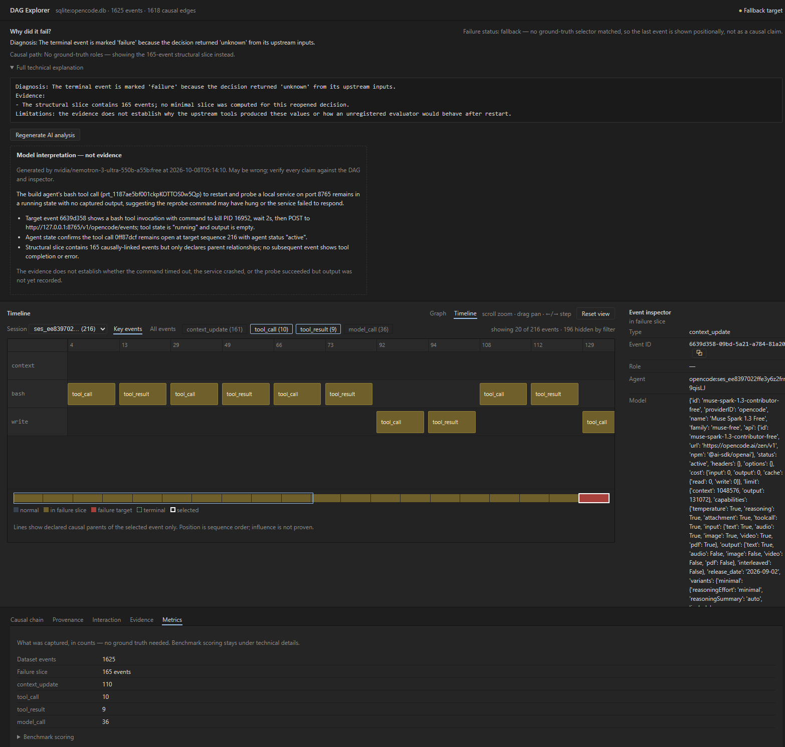
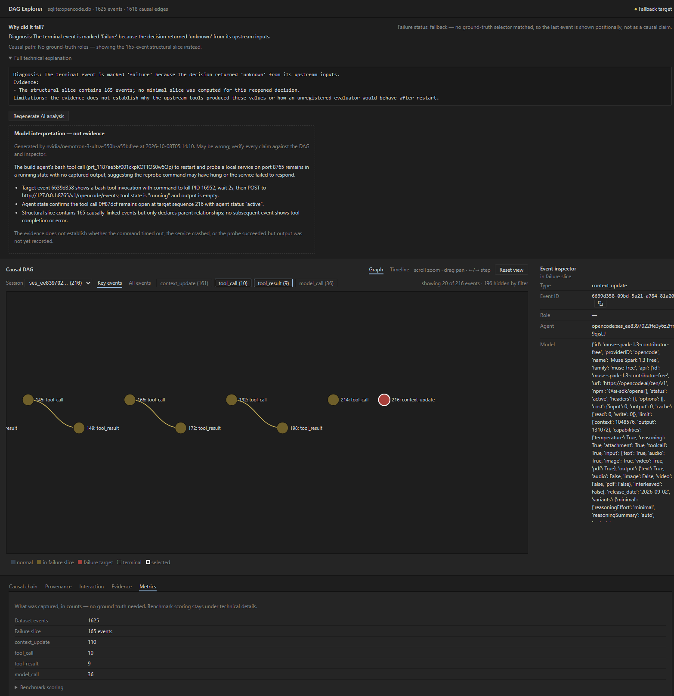

# Verification and Acceptance Procedures

> This phase-oriented acceptance guide is retained for detailed database and
> analytical verification. For current onboarding, commands, and the runnable
> demo, use [README.md](README.md) and [GETTING_STARTED.md](GETTING_STARTED.md).

Run the checks first:

```powershell
uv sync
.\scripts\check.ps1
```

## Benchmark verification

The benchmark phase is deliberately separate from normal unit testing and is
fully offline unless `--provider fastino` is passed. The fixture control is a
real SQLite capture/reopen regression, not a fixture graph self-comparison:

```powershell
uv run pytest tests/integration/test_customer_approval.py -q
uv run casuality-benchmark failure-injection
uv run casuality-benchmark scenarios
uv run casuality-benchmark experiment1 --repetitions 3
uv run casuality-benchmark experiment2 --dependencies 100
uv run casuality-benchmark experiment3
uv run casuality-benchmark baseline
```

`baseline` invokes `clay-good/agent-replay` at the pinned commit
`ccda6229a9451692fb6f1d6d323dd825c2be9dbb` once for each of the five
scenarios. It records the real `ingest`, `list`, and `diff` commands and scores
only divergence localization. Causal interactions, resource dependencies,
distractor reasoning, and minimal reduction remain explicitly unsupported.

The commands write machine-readable JSON and Markdown to `benchmark/results/`.
`experiment1.json` contains temperature/repetition interaction detections and
target evaluation; `experiment2.json` contains automatic memory/file resource
dependency recovery; `experiment3.json` contains each prompt-format intervention
failure category. Thresholds in the research memo remain hypotheses until a
stored result measures them. Fastino is opt-in: set `FASTINO_API_KEY` and
`FASTINO_MODEL`, optionally `FASTINO_BASE_URL` (default `https://api.fastino.ai/v1`), then add `--provider fastino`.
The JSONL response cache prevents an identical provider/model/prompt/config
request from being regenerated.

Most tests run locally against SQLite or the fixture and need no database.
PostgreSQL integration tests use the `DATABASE_URL` from `.env` when it is
set, and are skipped otherwise. They create the schema if needed and leave
test rows behind, so use a dedicated PostgreSQL database.

## Historical phase checks (archived)

The detailed Phase 2-4 database verification (sections 1-24: schema tables,
column types, indexes, ancestor queries, snapshots, provenance edges and
their SQL expectations) moved to
[docs/verification-archive.md](docs/verification-archive.md). Section numbers
there are unchanged. Day-to-day verification uses this file; reach for the
archive only for deep PostgreSQL inspection.

## Fixture CLI smoke (no database)

```powershell
uv run casuality --fixture fixture/fixture.json agents
uv run casuality --fixture fixture/fixture.json slice A4
uv run casuality --fixture fixture/fixture.json why A3
uv run casuality --fixture fixture/fixture.json reconstruct B 4
uv run casuality --fixture fixture/fixture.json provenance A3.output.approve
uv run casuality --fixture fixture/fixture.json replay dec_customer_approval_A3 customer_status=ineligible
uv run casuality --fixture fixture/fixture.json interaction dec_customer_approval_A3
uv run casuality --fixture fixture/fixture.json minimize A4
uv run casuality --fixture fixture/fixture.json explain A4 --no-llm
```

Expected: `slice A4` lists 9 events (no `D*`); `provenance
A3.output.approve` returns 4 exact edges; `minimize A4` reduces to 4 events
(`B3`, `C3`, `A3`, `A4`); `interaction` reports `1.0`; `explain` prints
`Diagnosis:` / `Evidence:` / `Limitations:` without an API key. Full
expectations live in sections 25-26 below.

## Focused test files

| Area | Command |
| --- | --- |
| Customer-approval SQLite control | `uv run pytest tests/integration/test_customer_approval.py -q` |
| Reducer / slicing / CLI | `uv run pytest tests/test_reducer.py tests/test_slicing.py tests/test_cli.py -q` |
| Replay / interaction / minimize | `uv run pytest tests/test_replay.py -v` |
| Provenance | `uv run pytest tests/test_provenance.py -v` |
| Explanation | `uv run pytest tests/test_explain.py -v` |
| OpenCode adapter (section 28) | `uv run pytest tests/test_opencode_adapter.py -v` |
| Explorer backend (section 29) | `uv run pytest tests/test_explorer.py -q` |

## PostgreSQL integration

Integration tests use `DATABASE_URL` from `.env`, self-skip without it, and
leave test rows behind — point them at a dedicated testing database, never a
shared one:

```powershell
uv run --env-file .env pytest -m integration -q
```

The SQL verification queries for schema, ancestors, snapshots, and
provenance isolation are in
[docs/verification-archive.md](docs/verification-archive.md).

---

## 25. Verify Phase 5: Counterfactual Replay, Interaction Attribution & Minimal Slicing

Purpose: confirms that the decision SCM replay engine evaluates semantic port substitutions, prevents dangerous side effects, minimizes structural slices using delta debugging, and computes Shapley-Owen interaction indices.

### Automated Test Suite Execution
```powershell
uv run pytest tests/test_replay.py -v
```

Expected result: the selected replay, attribution, and minimization tests pass,
verifying:
- Port baseline substitution (`do(Port_i = baseline)`).
- Side-effect safety enforcement (`ReplayUnsafe` exception thrown when tool is marked side-effecting).
- Shapley values $\phi_i$ and pairwise interaction index $I_{ij}$ with bootstrap standard errors.
- Minimal slice `ddmin` reduction on the customer approval scenario from 9 events to 4 events (`B3`, `C3`, `A3`, `A4`).

### CLI Verification Against Fixture
```powershell
# 1. Evaluate single counterfactual intervention
uv run casuality --fixture fixture/fixture.json replay dec_customer_approval_A3 customer_status=ineligible
# Expected: Original outcome: failure, Counterfactual outcome: success

# 2. Compute Shapley interaction index
uv run casuality --fixture fixture/fixture.json interaction dec_customer_approval_A3
# Expected: B3_x_C3 interaction value = 1.0, std_err = 0.0

# 3. Minimize structural slice via ddmin
uv run casuality --fixture fixture/fixture.json minimize A4
# Expected: Minimal slice of A4: 4 events (ddmin) -> B3, C3, A3, A4
```

---

## 26. Verify Phase 6: Grounded Causal Explanation

Purpose: verifies that `build_evidence_package` aggregates all structural, reconstructive, provenance, and interaction evidence into a unified package, and that `explain` generates faithful explanations using OpenRouter (`nvidia/nemotron-3-ultra-550b-a55b:free`).

### Automated Test Suite Execution
```powershell
uv run pytest tests/test_explain.py -v
```

Expected result: the focused suite verifies:
- Complete evidence package assembly for failure `A4` (structural slice, minimal slice, provenance chains, Shapley interaction, agent state).
- Fallback for events without decision contracts (`D3`).
- Error handling when `OPENROUTER_API_KEY` is missing.
- Mock HTTP transport verifying system prompt grounding principles (citing event IDs, distinguishing observations from inferences, noting exact provenance).
- Exponential backoff and retry behavior on HTTP 429 rate limits.
- Alignment with ground-truth acceptance criteria (L776–782).

### CLI Verification (Offline & Zero-Token)
```powershell
uv run casuality --fixture fixture/fixture.json explain A4 --no-llm --raw-evidence
```

Expected result:
- Full structured JSON containing `target_event`, `structural_slice` (9 events), `minimal_slice` (4 events: `B3`, `C3`, `A3`, `A4`), `interaction_attribution` ($B3 \times C3 = 1.0$), and exact fixture `provenance`.
- A plain-text summary with `Diagnosis:`, `Evidence:`, and `Limitations:` sections. The tested-chain line names the semantic inputs and reports four events; the interaction line names `customer_status` and `risk_score` without Python list formatting.

### Live Explanation with OpenRouter
```powershell
# Using the default model (nvidia/nemotron-3-ultra-550b-a55b:free, or override via --model / OPENROUTER_MODEL)
uv run casuality --fixture fixture/fixture.json explain A4
```

Expected result:
- A bounded explanation with `Diagnosis:`, `Evidence:`, and `Limitations:` sections.
- The semantic ports `customer_status` and `risk_score` are named, and readable fixture event IDs are cited when useful.
- The non-linear joint interaction between customer eligibility and risk is identified without claiming that structural ancestry alone proves influence.
- Exact and coarse provenance boundaries remain explicit.

---

## 27. End-to-End Real-World Scenario Testing Guide

How to exercise the debugger against a real multi-agent pipeline (staging):

### Step 1: Verify PostgreSQL connection

```powershell
Get-Content .env | Select-String "DATABASE_URL"
```

```sql
SELECT count(*) FROM runs;
SELECT count(*) FROM events;
```

### Step 2: Instrument the pipeline

Capture with `PostgresEventStore`, `spawn_agent`, `@capture_tool`
(with `field_sources`), `CapturedMemory`, `CapturedClient`, and
`create_decision_contract` for the merge decision.

### Step 3: Inject an interacting failure

Have two workers return faulty values (e.g. `customer_status = "eligible"`
plus `risk_score = 0.2`), merge them via the policy function, and mark the
wrong outcome as a failure — mirroring `examples/customer_approval.py`.

### Step 4: Run the Full Causal Diagnostic Battery via CLI
Query the real PostgreSQL run using the CLI:

```powershell
# 1. Structural slice isolates the causal cone from hundreds of irrelevant events:
uv run casuality slice <failure-event-uuid>

# 2. Audit field-level origins through tools:
uv run casuality provenance <decision-event-uuid>.output.approve

# 3. Minimize down to the minimal failure-inducing subset:
uv run casuality minimize <failure-event-uuid>

# 4. Measure whether failure was Branch 1, Branch 2, or Joint:
uv run casuality interaction <decision-contract-uuid>

# 5. Synthesize grounded explanation:
uv run casuality explain <failure-event-uuid>
```

### Step 5: Verification Checklist for Real Systems
- [ ] **DAG Completeness**: All intra-agent and cross-agent dependencies are connected without disconnected islands (`core.validator.check_intra_agent_continuity`).
- [ ] **Shared Memory Attribution**: Data consumed through a registered `CapturedMemory` resource URI traces back to its latest writer in the same run.
- [ ] **Exact vs. Coarse Honesty**: Values produced by deterministic tools are tagged `exact`; values generated by LLM reasoning boundaries are flagged `coarse`.
- [ ] **Interaction Isolation**: In joint failure modes, the interaction index $I_{ij} \gg 0$ identifies a combination effect rather than attributing the recorded outcome to one input alone.
- [ ] **Explanation Grounding**: The generated diagnosis names semantic inputs, uses readable event IDs when available, avoids unrecorded claims, and explains the joint interaction.

---

## 28. Verify OpenCode Runtime Adapter

Purpose: confirms that the OpenCode plugin adapter captures coding-agent sessions, translates them into the canonical event model without terminal scraping, feeds file reads/writes into the Resource-Version machinery, redacts sensitive tokens, and recovers causal graph ancestors.

### Automated Test Suite Execution

```powershell
uv run pytest tests/test_opencode_adapter.py -v
```

Expected result: all 17 adapter tests pass, verifying:
- **Event Mappings**: Translates `session.created` → `run_start`, `session.deleted` → `run_finish`, `session.error` → `agent_error`, `session.status`/`diff` → `context_update`, `message.updated` → `model_call`, `file.edited` → `tool_result`, `command.executed` → `tool_call`, `tool.execute.before/after` → `tool_call`/`tool_result`, `permission.ask` → `tool_call`.
- **Fail-Open Resilience**: Disk/storage exceptions in the event log or malformed HTTP payloads to `/v1/opencode/events` return HTTP 202 without crashing or interrupting OpenCode.
- **Resource Causality**: File writes registered via `file.edited` establish versioning in `ResourceRegistry`; subsequent tool calls reading the file auto-inject the writer event ID as causal parent.
- **Privacy Redaction**: Recursively strips `authorization`, `Bearer`, `sk-*`, `api_key`, `token`, and `password` values from headers, payloads, and nested arrays before persistence.
- **Timestamp Fidelity**: External OpenCode timestamps persist directly through SQLite rather than being overwritten with ingestion wall times.
- **Deterministic End-to-End Session**: 12-event simulated lifecycle executes through a live HTTP server, persists to SQLite, and produces an unbroken causal ancestor tree from `run_finish` back to `run_start`.

### Real Runtime Smoke Test Procedure

1. Launch receiver daemon in one terminal:
```powershell
uv run casuality-opencode-ingest --db .casuality/opencode.db
```

2. Run real OpenCode session in a second terminal:
```powershell
$env:CASUALITY_OPENCODE_INGEST_URL = "http://127.0.0.1:8765/v1/opencode/events"
opencode run "Inspect the repository, make a small testable change, and run pytest"
```

3. Validate persisted events and DAG connectivity:
```powershell
uv run python -c "
from storage.sqlite import SQLiteEventStore
store = SQLiteEventStore('.casuality/opencode.db')
events = store.events()
print(f'Total captured events: {len(events)}')
tools = [e for e in events if e.event_type in ('tool_call', 'tool_result')]
print(f'Captured tool events: {len(tools)}')
latest = events[-1]
ancestors = store.ancestors(latest.id)
print(f'Causal ancestors leading to latest event ({latest.id}): {len(ancestors)}')
"
```

## 29. Verify the Visual DAG Explorer

Purpose: confirms the read-only explorer (`explorer/`, five evidence endpoints plus opt-in `/api/ai-diagnosis`) and the Next.js frontend render captured traces truthfully — declared edges only, no invented causality — and that all automated gates pass.

### Automated Test Suite Execution

Backend (from repo root):
```powershell
uv run pytest tests/test_explorer.py -q
```

Expected result: all 11 explorer tests pass (endpoint shape, demo byte-identity, AI-diagnosis sections/cache/502/503 mapping).

Frontend (from `frontend/`):
```powershell
npm test
npx tsc --noEmit
npm run build
```

Expected result: `npm test` 131/131 (contract checks for IDs, endpoints, demo shape, pointer-capture ban, shared legend, trace-fact tab bodies, AI quarantine, plus unit tests for selection, viewport, render, inspector, timeline, filter, tracefacts); `tsc` strict clean; `next build` static export succeeds into `frontend/out/`.

Repo-wide gates (from repo root):
```powershell
uv run ruff check .
uv run ty check .
uv run pytest -q
```

Expected result: ruff and ty clean; full suite green (198 passed, 7 skipped — skips are postgres-integration).

### Live-Server Smoke Test Procedure

1. Start the explorer (default serves the bundled 10-envelope demo trace; `--db` points at a live capture):
```powershell
uv run python -m explorer.server --db .casuality/opencode.db --port 8797
```

2. Verify the evidence endpoints (replace `$port` if different):
```powershell
(Invoke-WebRequest http://127.0.0.1:8797/ -UseBasicParsing).StatusCode
(Invoke-RestMethod http://127.0.0.1:8797/api/overview).event_count
(Invoke-RestMethod http://127.0.0.1:8797/api/failure) | Select-Object status, method, is_fallback
(Invoke-RestMethod http://127.0.0.1:8797/api/evidence).status
```

Expected result: index `200`; overview returns the dataset event count; failure reports `resolved` (demo, selector matched) or `fallback_last_event` (live captures without ground truth — shown honestly as "Fallback target", never as a causal claim); evidence `ok`.

3. Verify the opt-in AI endpoint (requires `OPENROUTER_API_KEY` in the environment or repo `.env`; model via `OPENROUTER_MODEL`, otherwise the backend default):
```powershell
(Invoke-RestMethod http://127.0.0.1:8797/api/ai-diagnosis | ConvertTo-Json -Depth 4).Substring(0, 400)
```

Expected result: HTTP `200` with `{status: "ok", model, generated_at, sections: {diagnosis, evidence[], limitations}}`; the interpretation names the failure-relevant tool activity with honest limitations. Without a key expect HTTP `503 ai_unavailable`; on model/format failure expect HTTP `502` (the local template is never passed off as AI output). Repeats are instant (per-dataset in-memory cache).

### Manual UI Checklist (http://127.0.0.1:8797)

1. Header pill reads "Resolved" (demo) or "Fallback target" (live, amber) with an explanatory title — never "failure resolved".
2. "Why did it fail?" shows the one-sentence lede plus clickable role chips (demo) or the slice-size note (live, no ground-truth roles).
3. Graph|Timeline toggle: DAG shows depth-lane nodes with gold ancestor highlight on selection; Timeline shows run/model/context/tool lanes, ruler scrub, playhead, and minimap with viewport rectangle.
4. Filter bar: Key-events preset hides `context_update`/`model_call` streaming noise; the failure node stays pinned visible even when its type is hidden; session picker defaults to latest activity; counter reads "showing X of Y events".
5. Clicking any node/clip updates the inspector (Command + Result heroes for tool events, full field list, copy buttons) — Graph clicks must select, never misfire after a drag (6px drag-vs-click threshold).
6. Tabs: Causal chain lists slice events; Provenance shows per-resource chains (grounded grades when recorded, "Discovered in this trace" chains otherwise); Interaction shows recorded fan-out/fan-in or an honest linear-chain note; Evidence leads with the tool story; Metrics leads with the capture census — benchmark scoring stays collapsed under "Benchmark scoring"/"Technical metric details".
7. "Generate AI analysis" renders a dashed "Model interpretation — not evidence" block with model name and timestamp; nothing AI-related fetches on page load.

Reference states (live 1625-event capture, `ses_ee839702` session, Key events):






